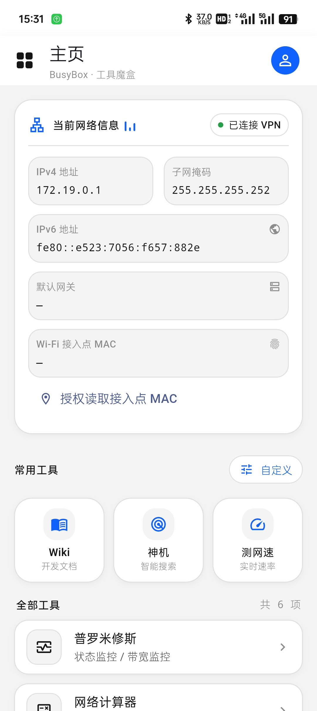
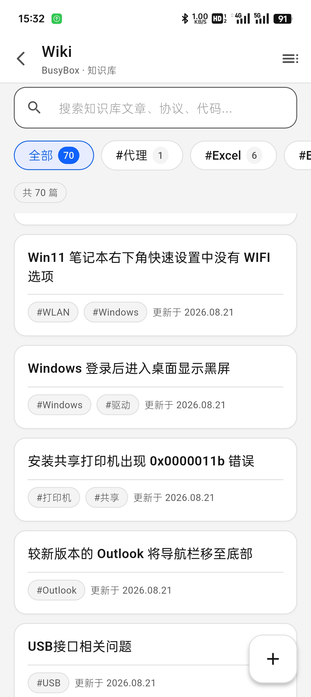

# BusyBox（demo1）

示例图：







一个基于 **Flutter + MVVM + Riverpod + go_router** 的工具集合应用。

## 功能

- **主页（工具盒）**：菜单按钮、首次进入品牌动画、个人中心入口、网络摘要、可自定义的常用工具；全部工具动态展示未固定项，Wiki 移出常用区后仍可打开；
- **侧边栏**：设置、统计（待开发）、关于APP；
- **自定义常用工具**：点击主页「自定义」后可增减最多六项常用工具，操作实时反映到主页并保存在本地；
- **界面配色模板**：主页、侧边栏、自定义页共用 `BusyBoxPalette`，通过 `ThemeExtension` 支持亮色与深色，为以后切换配色预留入口；
- **全局设置 → 深色模式**：明亮 / 黑暗主题切换，持久化保存；
- **Wiki 知识库**：新版卡片目录、带真实条目计数的关键词筛选和服务端搜索；阅读页支持四章正文、左右翻页、目录、代码语言标签及点击/长按复制，以及图片全屏缩放和系统分享；
- **Wiki 投稿**：账号登录、连续失败临时锁定、1 小时内存会话、七步所见即所得编辑器、列表自动续写、相机图片上传、关键词多选；总览默认使用阅读页样式预览，可切回编辑并确认提交；
- **网络信息**：当前连接状态（Wi-Fi / 移动数据 / 无连接）、设备网络详情（IP / 网关等）、
  网站连通延迟测试（每行 3 卡片）、网速测试（内嵌 test.ustc.edu.cn）。

> 迭代说明见 `doc/changelog/`，本次更新见 [Oct-7 更新说明](doc/changelog/update-Oct-7.md)。Wiki 参考稿位于 `doc/ui/wiki/`。

Sep-30 界面更新：主页与自定义页采用圆角卡片、轻阴影和圆形操作按钮，侧边栏使用本地原子图标。保留品牌标题动画、工具三列布局和常用图标蓝色。网络字段长按复制；柱条仅表示连接状态动效，非实时流量，连接变化时自动刷新摘要，断开后停播。

## 技术栈

| 层 | 说明 |
| --- | --- |
| UI | Flutter Widget |
| 状态管理 | flutter_riverpod（Notifier / AsyncNotifier） |
| 路由 | go_router（声明式路由，支持 Web 深链） |
| 网络 | http（封装于 core/network） |
| 架构 | MVVM：View（widgets）⇄ ViewModel（providers）⇄ Repository（data）⇄ Model |

## 目录结构

```
lib/
├── main.dart                     # 入口：ProviderScope + App
├── app/
│   ├── app.dart                  # 根组件（MaterialApp.router）
│   └── router/app_router.dart    # go_router 路由表
├── core/
│   ├── constants/app_constants.dart   # 全局常量（API 地址等）
│   ├── theme/                         # AppTheme + BusyBoxPalette 配色模板
│   └── network/                       # ApiClient 封装与依赖注入
├── features/
│   ├── home/                     # 主页工具盒模块
│   │   ├── models/               # 工具描述模型
│   │   ├── data/                 # 工具目录与路由常量
│   │   ├── viewmodel/            # 网络摘要与常用工具持久化
│   │   └── view/                 # HomePage、自定义页及子组件
│   ├── article/                  # Wiki 知识库模块
│   │   ├── models/               # Article / ArticleDraft / 投稿响应
│   │   ├── data/                 # 阅读与投稿 Repository
│   │   ├── viewmodel/            # 加载 / 搜索 / 草稿 ViewModel
│   │   └── view/                 # Wiki 首页 / 阅读页 / 七步投稿编辑器
│   ├── auth/                     # Wiki 登录、失败锁定和内存会话
│   ├── network/                  # 网络信息模块（连接状态/详情/延迟/网速测试）
│   ├── settings/                 # 全局设置（深色模式已实现）
│   ├── update/                   # 软件更新（占位）
│   └── about/                    # 关于 App
└── shared/
    └── widgets/                  # AppDrawer / MarkdownView 等共享组件
```

## 后期新增功能指南

1. 新建 `lib/features/<功能名>/` 模块，按 `models / data / viewmodel / view` 分层；
2. 在 `features/home/data/tool_registry.dart` 的 `AppRoutes` 中定义路由路径；
3. 在 `app/router/app_router.dart` 注册对应 `GoRoute`；
4. 根据展示位置在 `home_tool_options.dart` / `home_catalog.dart` 登记工具及路由；旧搜索页仍使用 `toolRegistryProvider`。

## 运行

```bash
flutter pub get
flutter run        # 选择可用设备（Windows / Chrome 等）
```

## 测试

```bash
flutter analyze    # 静态分析
flutter test       # 单元 + 组件测试（含 Mock 网络）
```
